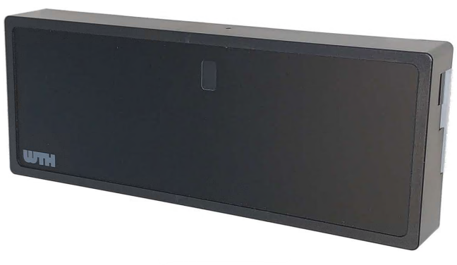

# WTH UMR2 Regulator for Home Assistant

This custom Home Assistant integration monitors a WTH UMR2 heating regulator over
the local network. It is not affiliated with WTH and currently provides read-only
sensor entities; it does not send commands to the regulator.

[](https://my.home-assistant.io/redirect/config_flow_start/?domain=wth_umr2)



## Attribution

This project is based on the original
[WTH UMR2 Home Assistant project](https://github.com/AbeltjeNL/wth_umr2), released
under the MIT License. It has been substantially revised for the controller's
local JSON API and current Home Assistant integration behavior.

## Requirements

- Home Assistant 2025.1.0 or newer
- A WTH UMR2 reachable from the Home Assistant host
- The regulator's IP address or resolvable hostname

The integration uses plain HTTP and has no external Python requirements.

## Installation

### HACS

Add this repository as a custom repository in HACS, choose **Integration**, and
install **WTH UMR2 Regulator**. Restart Home Assistant afterwards.

### Manual

Copy [`custom_components/wth_umr2`](custom_components/wth_umr2) into the
`custom_components` directory of the Home Assistant configuration directory,
then restart Home Assistant.

### Removal

Remove the WTH UMR2 integration from **Settings > Devices & services**. Select
the configured WTH UMR2 device, open the menu, and choose **Delete**. Restart
Home Assistant if the integration was installed manually.

## Configuration

1. Open **Settings > Devices & services**.
2. Select **Add integration** and search for **WTH UMR2 Regulator**.
3. Enter the regulator's IP address or hostname.
4. Submit the form.

The config flow validates the device before creating the entry and prevents the
same host from being configured more than once.

## Entities

One device is created for each configured regulator. The integration polls the status sections separately every 30 seconds to stay
within the controller's JSON response limit. Communication subsections are
requested individually because their device arrays can be large:

```text
http://<host>/get.json?f=$.status.version.*
http://<host>/get.json?f=$.status.main.*
http://<host>/get.json?f=$.status.inputs.*
http://<host>/get.json?f=$.status.process.*
http://<host>/get.json?f=$.status.outputs.*
http://<host>/get.json?f=$.status.communications.fanlink.*
http://<host>/get.json?f=$.status.communications.rf.*
http://<host>/get.json?f=$.status.communications.modbus.*
http://<host>/get.json?f=$.status.communications.bluetooth.*
http://<host>/get.json?f=$.status.communications.ethernet.*
http://<host>/get.json?f=$.status.communications.json.*
http://<host>/get.json?f=$.status.communications.usb.*
```

The responses are merged and used to create 114 sensors:

- Main state, operating mode, display, LED status, and heat/cool/PWM factors
- Heater, cooler, and pump output percentages
- Eight thermostat states and eight thermostat temperatures
- Ten valve positions
- Maximum, return, and condensate inputs
- Ten temperature inputs
- Power-stealing input status
- Fanlink, RF, Modbus, Bluetooth, JSON, USB, and Ethernet status
- Ten thermostat demand factors
- Ten devices each for Fanlink, RF, Modbus, and Bluetooth diagnostics
- PID tuning and output-factor diagnostics
- Firmware build and controller API version diagnostics

Temperature entities are created during setup, but each one is enabled by
default only when its first successful update reports a positive temperature.
This keeps inactive inputs out of the default entity list while supporting UMR2
installations that provide temperature data. Disabled entities can be enabled
manually from the device's entity settings.

Communication and connected-device entities are marked as diagnostic. Entity
availability follows the coordinator's last successful update.

## API expectations

The regulator must return HTTP 200 from each endpoint with a JSON object
containing a `status` object and the requested section. HTTP errors, timeouts,
connection failures, invalid JSON, and incomplete responses are reported as
update failures. The integration does not provide authentication, TLS, writes,
or service actions.

## Troubleshooting

- Confirm the host is reachable from the machine running Home Assistant.
- Check **Settings > System > Logs** for `wth_umr2` errors.
- Confirm each status endpoint returns JSON with a top-level `status` key.
- If the device was previously configured, remove the existing config entry
  before attempting to add the same host again.

## Project status

This project is being cleaned up and reworked. The current implementation is
small and intentionally documents only behavior present in the code.

## License

MIT License. See [`LICENSE`](LICENSE).